<div align="center">


# 无界工作室 · Infinite Studio

**在属于你自己的空间里写代码。**

极简、个性化的桌面 IDE，内置能读懂整个项目的 AI。<br>
界面只有灰阶，加一个你选的强调色。

[](https://github.com/JunjiDuan/infinite-studio/releases/latest)
[](https://github.com/JunjiDuan/infinite-studio/releases/latest)
[](https://github.com/JunjiDuan/infinite-studio/releases/latest)
<br>


[**下载**](https://github.com/JunjiDuan/infinite-studio/releases/latest) · [官网](https://infinite-project.top/studio/) · [反馈问题](https://github.com/JunjiDuan/infinite-studio/issues) · [参与贡献](#参与贡献)

</div>

<p align="center">
  <picture>
    <source media="(prefers-color-scheme: light)" srcset=".github/assets/readme/hero-light.webp">
    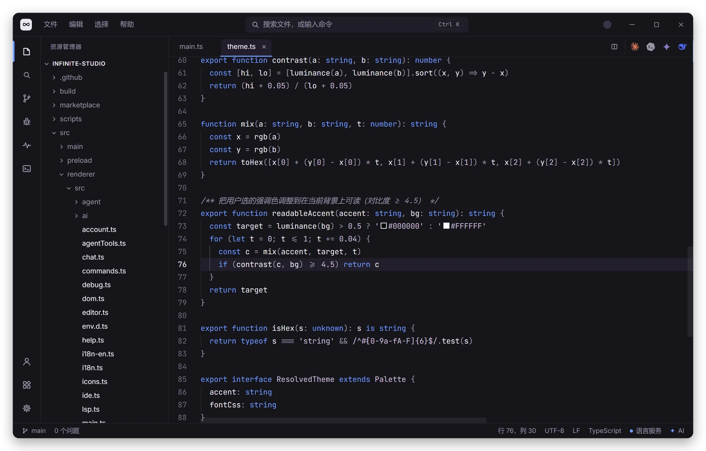
  </picture>
</p>

<p align="center"><i>编辑器应该是安静的：界面不抢眼，只有一种颜色有含义，每个工具都在手边。</i></p>

<br>

## ✦ 读懂整个项目的 AI

补全、内联编辑和修复直接内置在编辑器里。它们能看到你打开的标签页、你导入的定义和项目规则，模型由你自己选。

<table>
  <tr>
    <td width="50%" valign="top">
      <b>行内补全</b>&nbsp;&nbsp;<kbd>Tab</kbd><br>
      <sub>灰色提示帮你写完这一行或这一段，它会根据你的接受率调整出现的时机。</sub><br><br>
      <picture>
        <source media="(prefers-color-scheme: light)" srcset=".github/assets/readme/ai-complete-light.webp">
        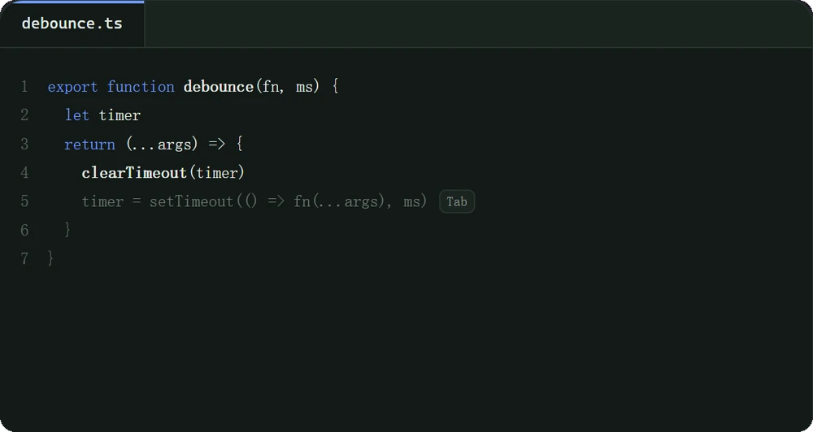
      </picture>
    </td>
    <td width="50%" valign="top">
      <b>内联编辑</b>&nbsp;&nbsp;<kbd>Ctrl</kbd> <kbd>I</kbd><br>
      <sub>在代码上方描述修改，结果以差异写进原处：<kbd>Ctrl</kbd> <kbd>Enter</kbd> 保留，<kbd>Esc</kbd> 恢复。</sub><br><br>
      <picture>
        <source media="(prefers-color-scheme: light)" srcset=".github/assets/readme/ai-edit-light.webp">
        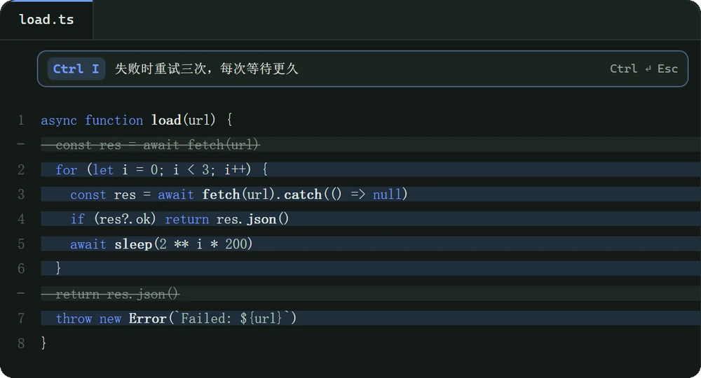
      </picture>
    </td>
  </tr>
  <tr>
    <td width="50%" valign="top">
      <b>用 AI 修复</b>&nbsp;&nbsp;<kbd>Alt</kbd> <kbd>Enter</kbd><br>
      <sub>每个错误和警告都有一个快速修复，把诊断和周围的代码一起交给模型。</sub><br><br>
      <picture>
        <source media="(prefers-color-scheme: light)" srcset=".github/assets/readme/ai-fix-light.webp">
        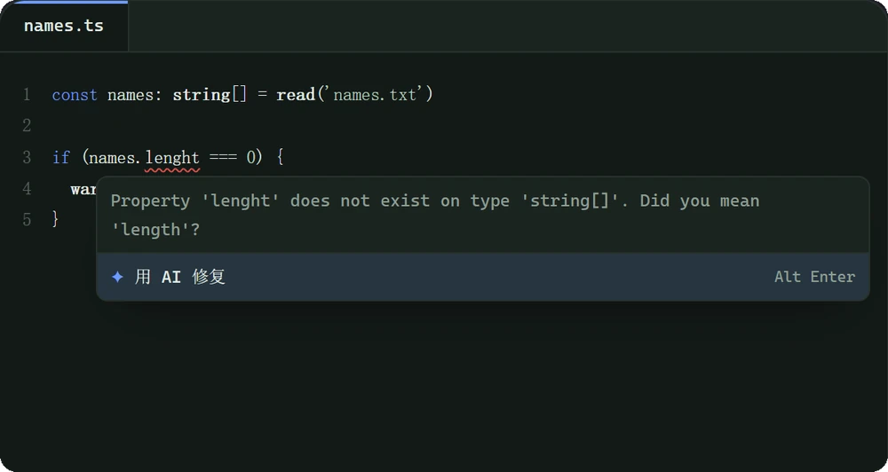
      </picture>
    </td>
    <td width="50%" valign="top">
      <b>下一处编辑</b>&nbsp;&nbsp;<kbd>Tab</kbd><br>
      <sub>改完一处后预测下一处该改哪里：<kbd>Tab</kbd> 跳过去，再按 <kbd>Tab</kbd> 应用。</sub><br><br>
      <picture>
        <source media="(prefers-color-scheme: light)" srcset=".github/assets/readme/ai-next-light.webp">
        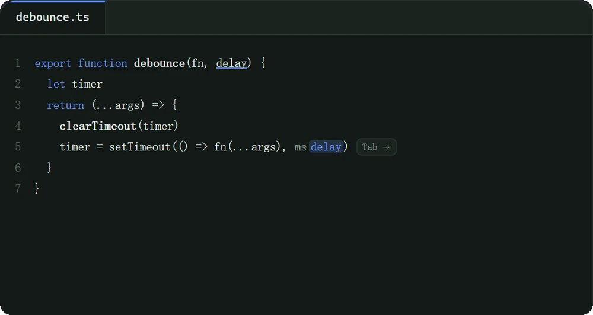
      </picture>
    </td>
  </tr>
</table>

| 🧭 懂你的项目 | 🔗 贯穿整个 IDE | 🔑 你的模型，你的密钥 |
| :-- | :-- | :-- |
| 上下文来自打开的标签页里的相似代码、语言服务给出的导入定义、全项目增量索引，以及 `.infinite/rules.md`、`AGENTS.md`、`CLAUDE.md` 里的规则。 | **终端**：构建、运行、测试报错一键“解释并修复”<br>**Git**：根据差异写提交信息、审查当前改动<br>**调试**：暂停时带着调用栈和变量提问 | 每个功能单独选服务和模型：DeepSeek、Kimi、Claude，或任何 OpenAI 兼容服务（包括本机 Ollama）。密钥用系统钥匙串加密，不会进入编辑器窗口。 |

<br>

## ◐ 八套主题，一个强调色

挑一个主题和强调色，Infinite Studio 会自动调整强调色，直到它在每个界面上都清晰可读。

<p align="center">
  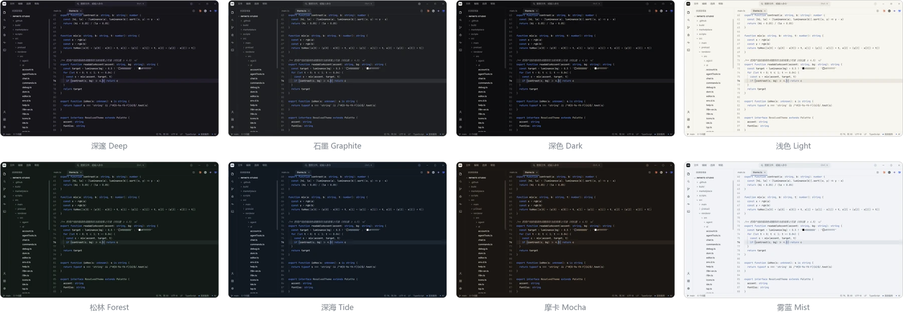
</p>

<table>
  <tr>
    <td width="62%">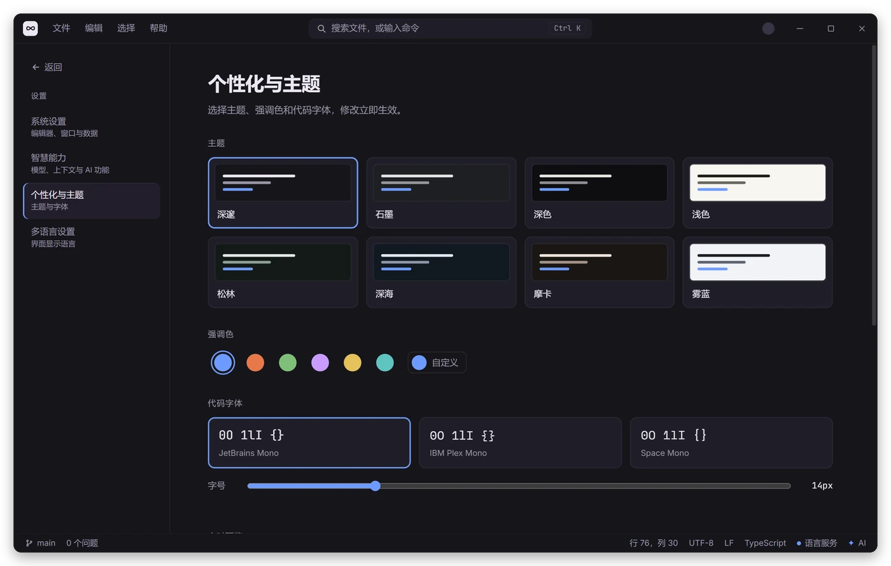</td>
    <td width="38%" valign="middle">
      <b>标题栏的主题弧</b><br>
      <sub>点一下标题栏的圆点，八套主题沿弧线展开，一键切换。</sub><br><br>
      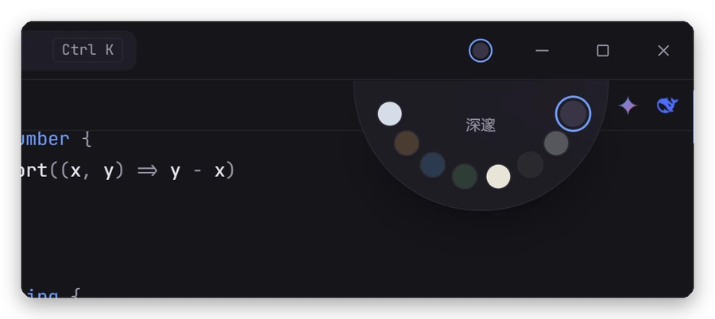<br><br>
      <b>个性化</b> <kbd>Ctrl</kbd> <kbd>,</kbd><br>
      <sub>六个预设强调色或任意自定义颜色 · JetBrains Mono / IBM Plex Mono / Space Mono · 字号 <kbd>Ctrl</kbd> <kbd>=</kbd> / <kbd>Ctrl</kbd> <kbd>-</kbd></sub>
    </td>
  </tr>
</table>

<br>

## ⌘ 趁手的一切

<table>
  <tr>
    <td width="33%" valign="top">
      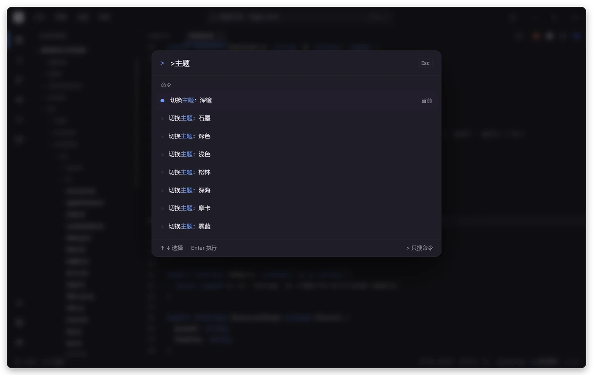<br>
      <b>命令面板</b> <kbd>Ctrl</kbd> <kbd>K</kbd><br>
      <sub>模糊搜索所有文件和命令，输入 <code>&gt;</code> 只搜命令。</sub>
    </td>
    <td width="33%" valign="top">
      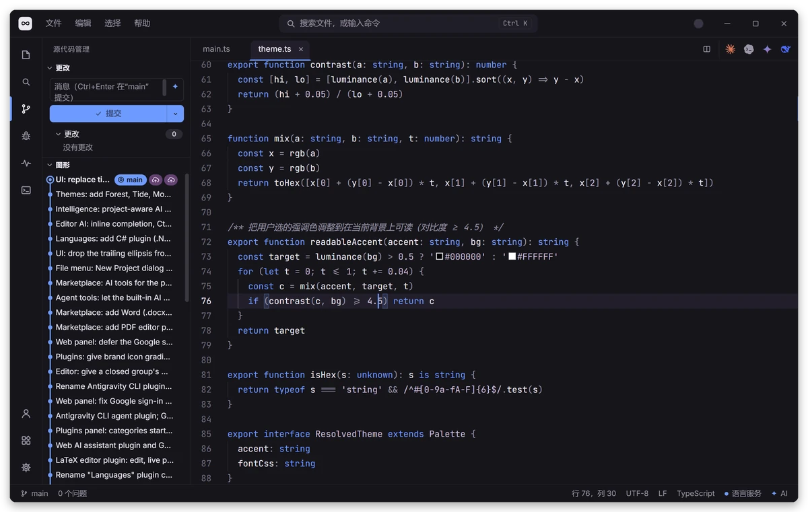<br>
      <b>源代码管理</b> <kbd>Ctrl</kbd> <kbd>Shift</kbd> <kbd>G</kbd><br>
      <sub>暂存、提交、拉取、推送和浏览历史，不用离开编辑器。</sub>
    </td>
    <td width="33%" valign="top">
      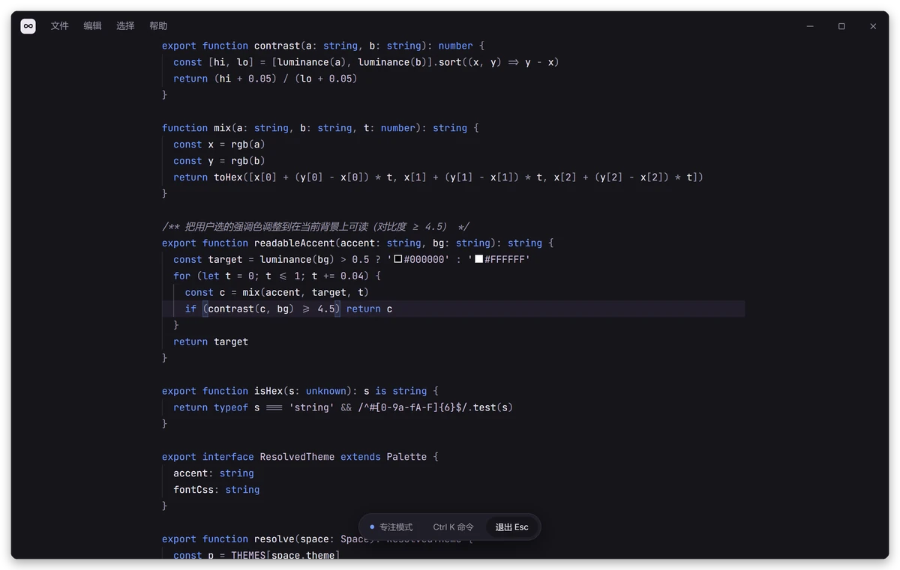<br>
      <b>专注模式</b> <kbd>Ctrl</kbd> <kbd>.</kbd><br>
      <sub>隐藏代码以外的一切，<kbd>Esc</kbd> 回来。</sub>
    </td>
  </tr>
</table>

| | | |
| :-- | :-- | :-- |
| ✏️ **Monaco 编辑** — VS Code 同款引擎：标签页、未保存标记、全部保存、磁盘变化自动重载 | 🧠 **语言智能（LSP）** — 诊断、补全、悬停、转到定义、查找引用、跨文件重命名、格式化、大纲 | 🔍 **搜索与替换** — 区分大小写 / 全字 / 正则，全部替换时跳过未保存的文件 |
| 🖥️ **集成终端** — 多个终端，配色跟随主题和强调色 | 🐞 **运行与调试** — 断点、单步、变量、调用栈，支持 Python、Java、C/C++、C# | 📦 **新建项目** — Java（Maven / Gradle）、Python、C/C++（CMake）、Node.js、C# 模板，缺什么工具链会告诉你怎么装 |
| 📓 **Jupyter** — 逐个单元格运行 `.ipynb` | 📄 **文档预览** — PDF、Office、图片、音视频直接在标签页里打开 | 📈 **系统监视器** — 处理器、内存、显卡、磁盘、网络一目了然 |

<br>

## ⧉ 只装你用得上的

TypeScript / JavaScript 开箱即用；其他语言用插件或你已经装好的语言服务，启用后自动接上。

<table>
  <tr>
    <td width="50%" valign="top">
      <b>编程语言</b><br><br>
      <br>
      <br>
      <br>
      <br>
      <br>
      <br>
      
    </td>
    <td width="50%" valign="top">
      <b>AI 代理</b><br><br>
      <br>
      <br>
      <br>
      <br>
      <br><br>
      <sub>每一轮改动的文件都会列出来，逐个保留或撤销。代理可以调用 IDE 自己的工具（转到定义、查找引用、Git 差异、运行测试），还能通过 MCP 使用每个插件提供的工具。</sub>
    </td>
  </tr>
</table>

**插件市场** — 在插件面板里安装、更新、卸载，每个包安装前校验 SHA-256，文档类插件直接在编辑器标签页里打开文件。

| `.docx` | `.pdf` | `.pptx` | `.tex` |
| :-- | :-- | :-- | :-- |
| **Word 文档**<br><sub>直接修改，批注和修订原样保留</sub> | **PDF 编辑器**<br><sub>改文字、签名、填表单、调整页面</sub> | **演示文稿**<br><sub>查看和编辑幻灯片</sub> | **LaTeX**<br><sub>即时预览与 PDF 编译</sub> |
| **`.md`** | **`.mind`** | **`.html`** | **web** |
| **Markdown**<br><sub>排版精美的阅读视图</sub> | **思维导图**<br><sub>键盘大纲，导出 PNG / SVG / Markdown</sub> | **HTML 预览**<br><sub>分栏、设备尺寸、控制台</sub> | **网页 AI**<br><sub>ChatGPT、Claude、Gemini、DeepSeek 侧栏</sub> |

<sub>界面内置中文和英文，另有七个语言包：Español · Français · Deutsch · 日本語 · 한국어 · Русский · العربية</sub>

<br>

## ⌨ 键盘优先

| | | | |
| :-- | :-- | :-- | :-- |
| <kbd>Ctrl</kbd> <kbd>K</kbd> 命令面板 | <kbd>Ctrl</kbd> <kbd>I</kbd> AI 内联编辑 | <kbd>Alt</kbd> <kbd>Enter</kbd> 快速修复 | <kbd>Ctrl</kbd> <kbd>Shift</kbd> <kbd>F</kbd> 文件中搜索 |
| <kbd>Ctrl</kbd> <kbd>`</kbd> 终端 | <kbd>Ctrl</kbd> <kbd>Shift</kbd> <kbd>G</kbd> 源代码管理 | <kbd>Ctrl</kbd> <kbd>B</kbd> 侧栏 | <kbd>Ctrl</kbd> <kbd>.</kbd> 专注模式 |
| <kbd>Ctrl</kbd> <kbd>,</kbd> 个性化 | <kbd>F12</kbd> 转到定义 | <kbd>F2</kbd> 重命名符号 | <kbd>Shift</kbd> <kbd>Alt</kbd> <kbd>F</kbd> 格式化 |

<br>

## ↓ 下载

<div align="center">

[](https://github.com/JunjiDuan/infinite-studio/releases/latest)
[](https://github.com/JunjiDuan/infinite-studio/releases/latest)
[](https://github.com/JunjiDuan/infinite-studio/releases/latest)

<sub>安装包未做代码签名，首次启动时 Windows SmartScreen 或 macOS Gatekeeper 可能需要你确认。应用可以在“帮助”菜单里检查更新。</sub>

</div>

<br>

## 参与贡献

Infinite Studio 以 MIT 许可证开源。需要 Git 和 Node.js，克隆后即可启动开发版本：

```bash
git clone https://github.com/JunjiDuan/infinite-studio.git
cd infinite-studio
npm install
npm run dev
```

- 🐛 **报告问题和想法** — 有东西坏了，或者缺了你依赖的语言或工具？[开一个 issue](https://github.com/JunjiDuan/infinite-studio/issues)，写上复现步骤或你想要的工作流。
- 🔀 **提交 Pull Request** — 欢迎修复、语言集成、插件和翻译。小而专注、描述简短的改动最容易审阅。[查看 PR](https://github.com/JunjiDuan/infinite-studio/pulls)
- 🧩 **写插件** — 官方插件源在 [`marketplace/`](marketplace)。

<br>

<div align="center">
<sub>MIT License · © 2026 JunjiDuan · <a href="https://infinite-project.top/studio/">infinite-project.top/studio</a></sub>
</div>
